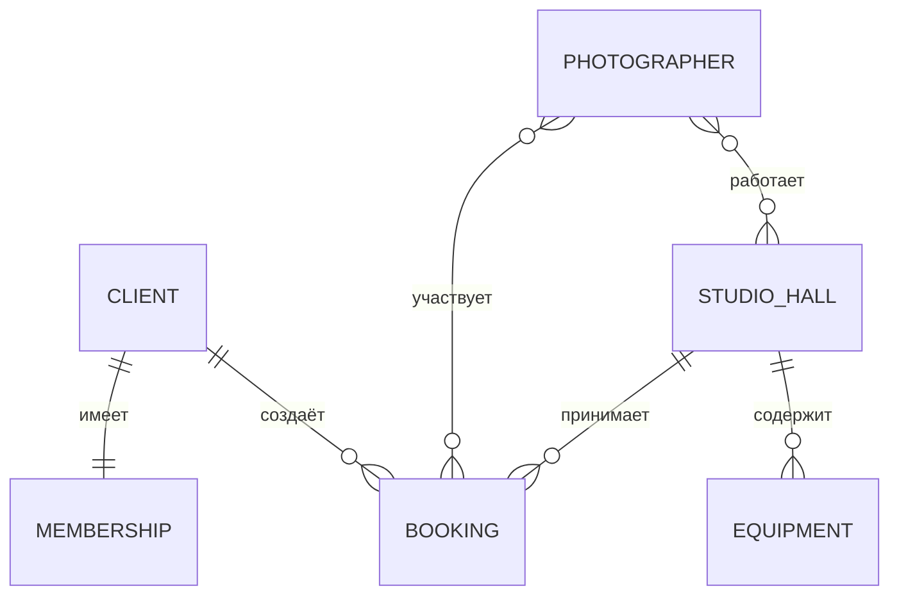
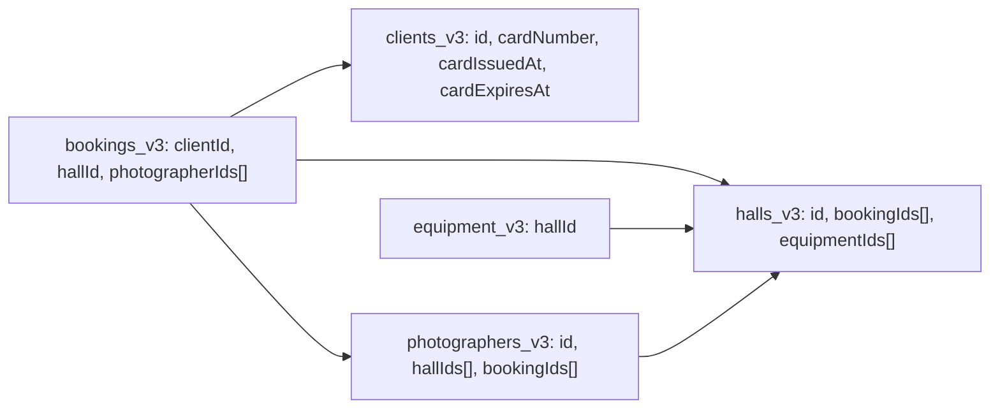

# Модель данных ПР3 — бронирование фотостудии

## Логическая схема

Пять основных сущностей: зал, фотограф, клиент, оборудование и бронирование. Абонемент — зависимая часть клиента, редактируется внутри его формы, отдельного списка не имеет.

Абонемент принадлежит одному клиенту, его номер уникален. В форме текущей версии номер обязателен. На уровне JSON отдельные поля допускают пустые значения для чтения старых данных.

## Физическая схема текущего хранилища

В ПР3 применяется localStorage через shared_preferences. Это схема фактического хранения JSON, а не SQL-таблицы будущего серверного приложения. Плагин может добавлять к ключам собственный префикс `flutter.`.

| Ключ приложения | Значение |
|---|---|
| `focus_frame_halls_v3` | JSON-массив StudioHall |
| `focus_frame_photographers_v3` | JSON-массив Photographer |
| `focus_frame_clients_v3` | JSON-массив Client с полями абонемента |
| `focus_frame_equipment_v3` | JSON-массив Equipment |
| `focus_frame_bookings_v3` | JSON-массив Booking |
| `focus_frame_migration_notice` | Служебное уведомление о миграции / восстановлении |

Связи хранятся идентификаторами. `hallId` и `clientId` — аналоги внешних ключей; `photographerIds` и `hallIds` представляют М:М. Обратные списки `bookingIds` и `equipmentIds` пересчитываются по исходным записям при запуске и при изменении бронирований / оборудования. Учитываются и записи корзины: логическое удаление сохраняет связь, физическое удаление убирает её.

В схеме серверной SQL-базы М:М можно вынести в таблицы `booking_photographers(bookingId, photographerId)` и `photographer_halls(photographerId, hallId)`, а абонемент — в `memberships(clientId UNIQUE, number UNIQUE, issuedAt, expiresAt)`. В текущем проекте эти SQL-таблицы не создаются.

## Словарь данных и проверки

Для всех пяти моделей общие служебные поля:

| Поле | Тип JSON | Назначение / проверка |
|---|---|---|
| `id` | integer | Идентификатор; назначает репозиторий, в форме не редактируется |
| `deletedAt` | string ISO 8601 / null | Дата логического удаления; null означает активную запись |

### Бронирование — Booking

| Поле | Тип | Назначение и ограничения ввода |
|---|---|---|
| `clientId` | integer | Обязательный выбор существующего активного клиента |
| `clientName` | string | Снимок имени выбранного клиента; заполняется автоматически |
| `email` | string | Обязательно, до 254 символов, формат электронной почты |
| `accessCode` | string | Уникальный код среди активных броней, 6–40 символов, латиница / цифры / дефис, сохраняется в верхнем регистре |
| `hallId` | integer | Обязательный выбор активного зала из репозитория |
| `photographerIds` | integer[] | Минимум один активный фотограф, доступный в выбранном зале |
| `date` | string ISO 8601 | Ввод ГГГГ-ММ-ДД, реальный календарный день, новая дата не в прошлом; прежнюю дату существующей брони можно оставить |
| `durationHours` | integer | Целое от 1 до 24 |
| `participants` | integer | Положительное целое, не больше вместимости выбранного зала |
| `shootingType` | string | Обязательно, 3–40 символов |
| `comment` | string | Необязательно, до 300 символов |

### Зал — StudioHall

| Поле | Тип | Назначение и ограничения ввода |
|---|---|---|
| `name` | string | Обязательно, 2–80 символов |
| `code` | string | Обязательно, 2–12 символов; латиница / цифры / дефис; уникальность среди активных залов без учёта регистра |
| `style` | string | Обязательно, 3–40 символов; значения справочника из залов, при пустом справочнике текстовый ввод |
| `capacity` | integer | Положительное целое |
| `hourlyRate` | integer | Цена за час от 500 до 100000 рублей |
| `equipmentIds` | integer[] | Производный список оборудования зала; в форме не редактируется |
| `bookingIds` | integer[] | Производный список бронирований зала; в форме не редактируется |

### Фотограф — Photographer

| Поле | Тип | Назначение и ограничения ввода |
|---|---|---|
| `firstName` | string | Обязательно, 2–50 символов |
| `lastName` | string | Обязательно, 2–50 символов; сочетание имени и фамилии уникально среди активных фотографов |
| `specialization` | string | Обязательно, 3–40 символов, справочник из репозитория или текст при пустом справочнике |
| `bio` | string | Необязательно, до 500 символов |
| `experienceYears` | integer | Целое от 0 до 60 |
| `hourlyRate` | integer | Ставка от 500 до 100000 рублей в час |
| `hallIds` | integer[] | Минимум один зал; только активные залы; нельзя убрать зал с активными бронированиями этого фотографа |
| `bookingIds` | integer[] | Производный список бронирований; в форме не редактируется |

### Клиент — Client, включая абонемент

| Поле | Тип | Назначение и ограничения ввода |
|---|---|---|
| `name` | string | Обязательно, 2–80 символов |
| `email` | string | Обязательно, до 254 символов, формат почты; уникальность среди активных клиентов без учёта регистра |
| `phone` | string | Обязательно, 6–15 цифр; допустимы + в начале, пробелы, дефисы и скобки; проверка уникальности текущего строкового представления |
| `clientType` | string | Обязательный выбор типа; частный или корпоративный; прежние значения также читаются из репозитория |
| `company` | string | Для корпоративного клиента обязательно, 2–80 символов; для частного сохраняется пустым |
| `cardNumber` | string | Обязательно, 4–20 символов, буквы / цифры / дефис; уникальность среди активных клиентов без учёта регистра |
| `cardIssuedAt` | string ГГГГ-ММ-ДД | Обязательно, реальная дата, не раньше 1 января (текущий год − 10), не позже сегодня |
| `cardExpiresAt` | string ГГГГ-ММ-ДД | Необязательно; при заполнении реальная дата, не раньше 1 января (текущий год − 10) и даты выдачи |
| `notes` | string | Необязательно, до 500 символов |

Поля `cardNumber`, `cardIssuedAt`, `cardExpiresAt` образуют вложенную группу «Абонемент» в общей форме клиента.

### Оборудование — Equipment

| Поле | Тип | Назначение и ограничения ввода |
|---|---|---|
| `name` | string | Обязательно, 2–80 символов; уникальное название в пределах зала среди активного оборудования |
| `category` | string | Обязательно, 3–30 символов; справочник из репозитория или текст при пустом справочнике |
| `manufacturer` | string | Необязательно, до 60 символов |
| `hallId` | integer | Обязательный выбор существующего активного зала |
| `quantity` | integer | Положительное целое |
| `pricePerDay` | integer | Цена за день от 0 до 100000 рублей |

## Правила целостности

- Удаление зала блокируется при наличии зависимых броней, оборудования или привязанных фотографов.
- Удаление клиента и фотографа блокируется при наличии зависимых броней.
- Для логического удаления проверяются активные зависимости; для физического — также логически удалённые.
- Массовая операция сначала проверяет весь набор и лишь затем изменяет записи.
- Восстановление повторно проверяет уникальность и существование связанных активных записей.
- При смене зала список фотографов сужается; несовместимые выбранные значения снимаются. Проверка повторяется репозиторием.
- Ошибки уникальности и связей показываются под соответствующим полем; ошибки удаления — в сообщении или состоянии ошибки списка.

## Границы ПР3

В этом проекте нет SQL-сервера, платежей, авторизации и проверки пересекающихся временных интервалов: модель брони хранит дату и длительность без времени начала. Это возможное развитие последующих работ, не состав выполненной ПР3.
